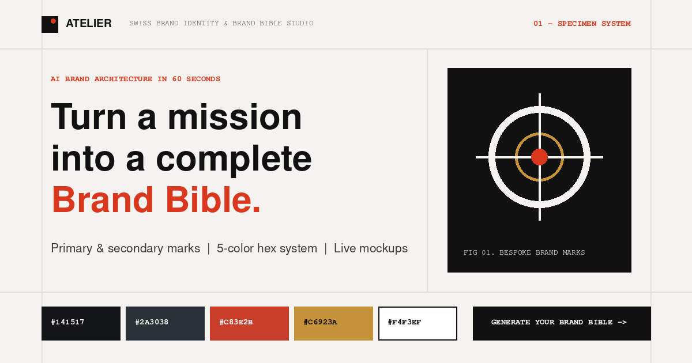

# ATELIER — AI Brand Identity & Swiss Brand Bible Studio

**Turn a one-sentence company mission into a complete, production-ready Swiss editorial Brand Bible in 60 seconds.**

 

---

## Why Atelier?

Most AI logo generators output a random clip-art icon with zero design system behind it. **Atelier** approaches brand creation like a Swiss graphic design studio: enter your company mission and target audience, and Atelier synthesizes a cohesive, structured identity system ready for both founders and developers.

### What Atelier Generates in 60 Seconds
- **01. Strategic Positioning & Voice Pillars** — Crisp editorial positioning, tagline, and brand voice principles.
- **02. Coordinated 3-Mark Identity Suite** — Primary Geometric Emblem, 1:1 Compact Monogram (favicon / app icon), and Secondary Seal/Stamp with high-resolution PNG and crisp SVG vector export.
- **03. Five-Color Architectural Hex System** — 60-30-10 color hierarchy with contrast pairings, usage notes, and 1-click CSS custom properties (`tokens.css`).
- **04. Live Google Font Pairings & Type Specimen** — Dynamically loaded display & body typefaces with an interactive specimen you can type in live.
- **05. Real-Time Digital & Stationery Mockups** — Preview your brand across web UI, business cards, and print sheets immediately.
- **06. Principal Creative Director AI** — Docked studio partner grounded in your exact hex codes, typography, and brand positioning.
- **07. One-Click Sharing & Export** — Publish read-only shareable Brand Bible links, download 1200×630 Swiss Social Showcase Cards (PNG), or export a complete Brand Kit ZIP (`tokens.css`, `brand-bible.json`, SVG/PNG marks, and print sheet).

> **Try it free in your browser — no login required for your first Brand Bible:**  
> **[https://atelier-brand-studio.web.app](https://atelier-brand-studio.web.app?utm_source=github)**

---

## Live Interactive Brand Bible Examples

Inspect complete Brand Bibles synthesized across 8 industries:

| Industry | Brand Specimen | Live Interactive Link |
| :--- | :--- | :--- |
| **Architecture & Spatial Design** | **Kuro Studio** | [View Brand Bible →](https://atelier-brand-studio.web.app/examples/kuro-architecture-brand-bible?utm_source=github) |
| **Specialty Coffee Roastery** | **Sora Roasters** | [View Brand Bible →](https://atelier-brand-studio.web.app/examples/sora-specialty-coffee-brand-guidelines?utm_source=github) |
| **Botanical Skincare** | **Verve Apothecary** | [View Brand Bible →](https://atelier-brand-studio.web.app/examples/verve-botanical-skincare-brand-bible?utm_source=github) |
| **Hi-Fi Audio Engineering** | **Klang Acoustics** | [View Brand Bible →](https://atelier-brand-studio.web.app/examples/klang-audio-engineering-brand-identity?utm_source=github) |
| **Editorial Fashion House** | **Maison Nori** | [View Brand Bible →](https://atelier-brand-studio.web.app/examples/maison-nori-editorial-fashion-guidelines?utm_source=github) |
| **Spatial Computing & AI** | **Vektor Spatial** | [View Brand Bible →](https://atelier-brand-studio.web.app/examples/vektor-spatial-computing-brand-system?utm_source=github) |
| **Institutional Fintech** | **Veritas Ledger** | [View Brand Bible →](https://atelier-brand-studio.web.app/examples/veritas-ledger-fintech-brand-guidelines?utm_source=github) |
| **Developer Cloud SaaS** | **Monolith Cloud** | [View Brand Bible →](https://atelier-brand-studio.web.app/examples/monolith-cloud-saas-brand-bible?utm_source=github) |

---

## Feedback & Feature Requests

Have an idea for a new export format (Tailwind v4 config, Figma tokens, SVG favicon pack) or a design system feature?  
[Open an Issue](https://github.com/BrangaVB/atelier-brand-studio/issues) or star this repository to follow upcoming releases.

---

  Built with precision · <a href="https://atelier-brand-studio.web.app?utm_source=github">atelier-brand-studio.web.app</a>

